# Gerenciador de Tarefas — React

## Descrição

Aplicação web desenvolvida como atividade acadêmica da aula de Frameworks Front-end do SENAI. O projeto permite cadastrar, visualizar, concluir, filtrar e excluir tarefas.

## Funcionalidades

- Cadastro de tarefas com título e descrição.
- Listagem dinâmica de tarefas.
- Marcação de tarefas como concluídas ou pendentes.
- Filtros por situação.
- Exclusão de tarefas.
- Resumo com total de tarefas, pendentes e concluídas.
- Mensagem condicional quando não existem tarefas.
- Interface responsiva.

## Tecnologias utilizadas

- React
- JavaScript
- Vite
- HTML com JSX
- CSS

## Conceitos React aplicados

- **JSX:** estrutura da interface.
- **Componentes:** divisão da aplicação em partes reutilizáveis.
- **Props:** passagem de dados e funções entre componentes.
- **Estado (`useState`):** gerenciamento das tarefas, dos campos e dos filtros.
- **Virtual DOM:** atualização da interface gerenciada pelo React.
- **Listas e keys:** utilização de `map()` e `key` para renderizar tarefas.
- **Renderização condicional:** exibição de mensagens conforme os dados.
- **Métodos de arrays:** uso de `map()` e `filter()` para atualizar e filtrar tarefas.

## Como executar o projeto

1. Instale o Node.js.
2. Clone ou baixe este repositório.
3. Abra a pasta do projeto no terminal.
4. Instale as dependências:

   ```bash
   npm install
   ```

5. Inicie o servidor de desenvolvimento:

   ```bash
   npm run dev
   ```

6. Abra no navegador o endereço informado pelo Vite.

## Observação

As tarefas são armazenadas no estado da aplicação. Por isso, não ficam salvas permanentemente após recarregar a página.


## Modelagem em Árvore dos Componentes

O diagrama abaixo representa a hierarquia dos componentes e a organização do Gerenciador de Tarefas.

```mermaid
flowchart TD
    A["Gerenciador de Tarefas"] --> B["App"]

    B --> C["Cabeçalho"]
    B --> D["Resumo de Tarefas"]
    B --> E["Formulário de Tarefas"]
    B --> F["Lista de Tarefas"]

    C --> C1["Título da aplicação"]
    C --> C2["Descrição"]

    D --> D1["Total de tarefas"]
    D --> D2["Tarefas pendentes"]
    D --> D3["Tarefas concluídas"]

    E --> E1["Campo de título"]
    E --> E2["Campo de descrição"]
    E --> E3["Botão adicionar"]

    F --> G["Filtro de Tarefas"]
    F --> H["Item de Tarefa"]

    G --> G1["Todas"]
    G --> G2["Pendentes"]
    G --> G3["Concluídas"]

    H --> H1["Título e descrição"]
    H --> H2["Status da tarefa"]
    H --> H3["Concluir ou reabrir"]
    H --> H4["Excluir tarefa"]

    B -.-> I["Conceitos React"]
    I --> I1["JSX e Componentes"]
    I --> I2["Props e useState"]
    I --> I3["Listas e Keys"]
    I --> I4["Renderização condicional"]
    I --> I5["Virtual DOM"]

    classDef principal fill:#173b70,color:#ffffff,stroke:#102b52,stroke-width:2px
    classDef componente fill:#dbeafe,color:#173b70,stroke:#3b82f6,stroke-width:1px
    classDef detalhe fill:#f8fafc,color:#334155,stroke:#cbd5e1,stroke-width:1px
    classDef conceito fill:#ede9fe,color:#4c1d95,stroke:#8b5cf6,stroke-width:1px

    class A,B principal
    class C,D,E,F,G,H componente
    class C1,C2,D1,D2,D3,E1,E2,E3,G1,G2,G3,H1,H2,H3,H4 detalhe
    class I,I1,I2,I3,I4,I5 conceito
```


